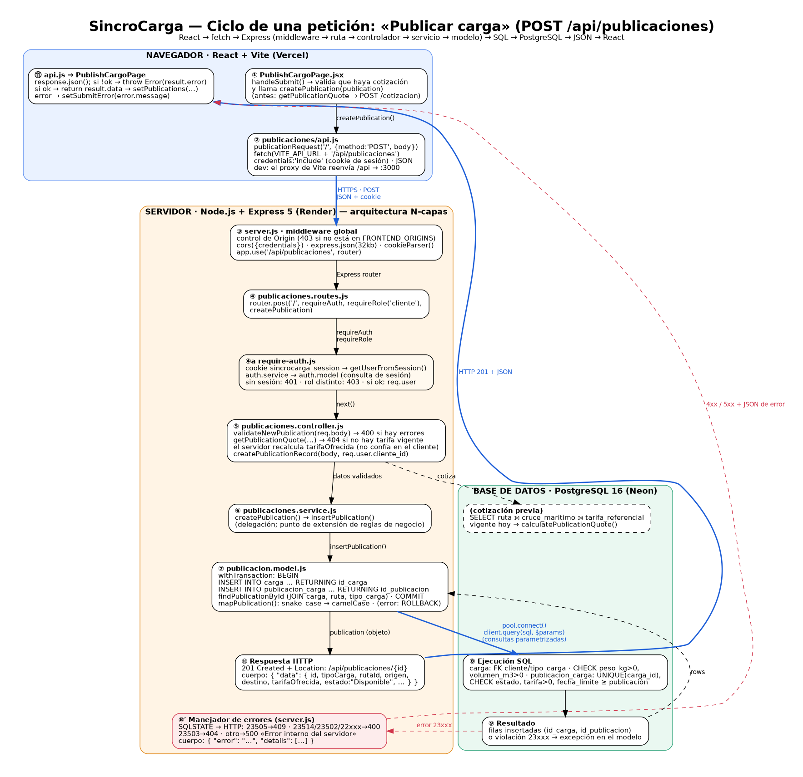

# SincroCarga

**Plataforma web de matching logístico para Chiloé.** Conecta camiones con espacio disponible y empresas con carga por transportar, para reducir los viajes de retorno vacíos, los costos de combustible y peajes (Pargua–Chacao) y la coordinación manual por WhatsApp.

Proyecto Web Integrador · Tecnologías Web y Móviles (6° semestre) · Ingeniería Civil en Informática · Universidad de Los Lagos, Campus Chiloé.

---

## 1. Enlaces y estado

| Elemento | Enlace |
|---|---|
| Repositorio | https://github.com/fatekiDev/SincroCarga-ProyectoWeb |
| Frontend (Vercel) | `[COMPLETAR: URL pública HTTPS]` |
| Backend (Render) | `https://sincrocarga-api.onrender.com` `[CONFIRMAR]` |
| Verificación de la API | `<URL del backend>/api/health/db` → `{ "status": "ok", "database": "connected" }` |
| Base de datos | PostgreSQL 16 gestionado en Neon (la cadena de conexión vive solo en la variable `DATABASE_URL` de Render) |
| Dossier técnico | `docs/` y el PDF de la entrega |

> El backend corre en el plan gratuito de Render: la primera petición tras un período de inactividad puede tardar hasta ~60 s en "despertar" la instancia.

### Equipo

| Integrante | Rol declarado |
|---|---|
| Benjamin Concha Monsalves | Backend y despliegue |
| Francisco Kroff Inzunza | Base de datos y DevOps |
| José Guanel Vera | Frontend |
| Vicente Garin Pereda | QA y documentación |

---

## 2. Alcance real y modo demostración

| Funcionalidad | Estado | Detalle |
|---|---|---|
| Registro, inicio de sesión y roles (cliente, camionero, admin) | Real | Cuentas, sesiones y contraseñas (hash bcrypt) en PostgreSQL |
| Publicar carga, cotizar y postular | Real | Todo persiste en PostgreSQL; la tarifa se calcula en el servidor |
| Panel de administración | Real | Los 9 endpoints `/api/admin/*` consultan y actualizan PostgreSQL |
| Pago | **Demostración** | Pago simulado, sin pasarela: se registra en la tabla `pago` (comisión e IVA) pero no mueve dinero. Está rotulado en la interfaz |
| Seguimiento con mapa | **Demostración** | Sin GPS: la posición del marcador avanza en memoria; los estados del viaje sí vienen de la base de datos |
| Verificación de documentos del conductor | Parcial | Los archivos se eligen en el navegador y no se almacenan; el estado (Pendiente, Verificado, Rechazado) sí se persiste y lo gestiona el administrador |
| Creación de `match` y `viaje` | Parcial | La API los lee y actualiza, pero no los crea; para la demostración se cargan por SQL |
| Tablas `comunicacion` y `notificacion` | Sin uso | Existen en el modelo; el backend aún no las utiliza |

---

## 3. Stack tecnológico

| Capa | Tecnología |
|---|---|
| Frontend | React 19, Vite, React Router 7, Leaflet / react-leaflet, jsPDF, lucide-react, oxlint |
| Backend | Node.js (ES Modules), Express 5, cookie-parser, cors, express-rate-limit, bcryptjs, dotenv, `pg` (pool) |
| Base de datos | PostgreSQL 16, esquema `bd_grupo2_sincrochiloe`, migraciones 001 a 005 |
| Despliegue | Vercel (frontend), Render (backend), Neon (PostgreSQL) |
| Calidad | `node:test` (15 pruebas), GitHub Actions (integración continua y verificación de producción) |

---

## 4. Arquitectura N-capas

El backend es un servidor Express con una responsabilidad por carpeta. El frontend consume la API con `fetch` (`credentials: "include"`) y la sesión viaja en una cookie `HttpOnly`.

```
React (frontend/src)  →  fetch + cookie
   └─ Middleware global (server.js: origen, CORS, JSON 32 kb, cookie-parser, errores)
       └─ Rutas        backend/src/routes        método + ruta + middlewares de sesión y rol
           └─ Controladores  backend/src/controllers  validan la petición y definen el código HTTP
               └─ Servicios      backend/src/services     reglas de negocio (validación, tarifa, hash, comisión/IVA)
                   └─ Modelos        backend/src/models       SQL parametrizado y transacciones
                       └─ PostgreSQL (pool en backend/src/db)  →  JSON { data } / { error }
```

Diagrama completo del ciclo de una petición (`POST /api/publicaciones`): [`docs/flujo-peticion.md`](docs/flujo-peticion.md) y [`docs/img/flujo-peticion.png`](docs/img/flujo-peticion.png).



> El módulo de administración no tiene capa de servicios propia: su controlador valida los parámetros y llama directamente al modelo.

### Decisiones de seguridad

- **Sesión:** cookie `sincrocarga_session` HttpOnly de 7 días (`Secure` y `SameSite=None` en producción). En la base solo se guarda el hash del token (`usuario_sesion.token_hash`).
- **Contraseñas:** bcrypt con 12 rondas; mínimo 12 caracteres y máximo 72 bytes.
- **Autorización por rol en el servidor** (`requireRole`); el propietario del recurso sale de la sesión, nunca del cuerpo. Las operaciones del camionero exigen cuenta verificada y activa.
- **Límite de intentos:** 10 logins cada 15 minutos (responde 429).
- **CORS:** lista blanca en `FRONTEND_ORIGINS`; en producción un origen no listado recibe 403.
- **Entrada:** cuerpo JSON limitado a 32 kb, validación en servidor y consultas SQL parametrizadas.
- **Errores:** el manejador global traduce errores de PostgreSQL (23505 → 409; 23502/22001/22003/22007/22P02/23514 → 400; 23503 → 404) y responde 500 con mensaje genérico, sin filtrar trazas.
- **Tarifa:** se recalcula siempre en el servidor (peso facturable = máx(peso real, volumen × 250 kg/m³); primer tramo de 1.000 kg; +15 % por tramo adicional; recargo de cruce marítimo aparte). Los parámetros son orientativos y deben calibrarse con costos reales.

---

## 5. Modelo de datos

24 tablas (21 del DDL base + `usuario`, `usuario_sesion` y `rut_registrado`), 31 claves foráneas sin `NO ACTION`. Los registros financieros y de historial usan `ON DELETE RESTRICT`; los hijos puramente dependientes usan `CASCADE`. Hay `CHECK` de estados, positividad y coherencia de fechas, y restricciones `EXCLUDE` que impiden solapar períodos.


- Diagrama completo: [`docs/diagrama-er.md`](docs/diagrama-er.md) y [`docs/img/diagrama-er.svg`](docs/img/diagrama-er.svg) (vectorial).
- Revisión de restricciones y hallazgos abiertos: [`docs/revision-restricciones.md`](docs/revision-restricciones.md).

| Dominio | Tablas |
|---|---|
| Catálogos y tarifas | `tipo_cliente`, `tipo_carga`, `cruce_maritimo`, `ruta`, `tarifa_referencial` |
| Actores y flota | `cliente`, `transportista`, `camion`, `chofer`, `camion_tipo_carga` |
| Flujo operativo | `carga`, `publicacion_carga`, `publicacion_transporte`, `postulacion`, `match`, `viaje`, `pago` |
| Interacción e historial | `calificacion`, `comunicacion`, `historial_cumplimiento`, `notificacion` |
| Autenticación | `usuario`, `usuario_sesion`, `rut_registrado` |

### Migraciones (`databases/migrations`, orden fijado en `backend/src/db/migrate.js`)

| Archivo | Contenido |
|---|---|
| `001_authentication.sql` | `usuario` y `usuario_sesion` |
| `002_unique_trip_rating.sql` | Una calificación por viaje y emisor |
| `003_simulated_payments.sql` | Tabla `pago` (tarifa, comisión, IVA, total) |
| `004_unique_rut.sql` | `rut_registrado`: unicidad del RUT normalizado |
| `004_admin_verification.sql` | Rol admin y estado de verificación del transportista |
| `005_hardening_constraints.sql` | `ON DELETE RESTRICT` explícito, 14 `NOT NULL` y 8 `CHECK` |

---

## 6. API REST

Convenciones: cuerpo `application/json`; éxito `{ "data": … }`; error `{ "error": "mensaje", "details": [ … ] }` (`details` solo en validaciones). Códigos usados: 200, 201, 400, 401, 403, 404, 409, 429, 500 y 503. La API **no borra filas de negocio**: cancelar y retirar son borrado lógico (cambio de estado), expuestos tanto con `POST` como con su `DELETE` equivalente.

| Grupo | Método y ruta | Acceso |
|---|---|---|
| Salud | `GET /api/health` · `GET /api/health/db` | Público |
| Auth | `POST /api/auth/register` · `POST /api/auth/login` (10 / 15 min) | Público |
| Auth | `GET /api/auth/me` · `POST /api/auth/logout` · `DELETE /api/auth/session` | Sesión |
| Publicaciones | `GET /api/publicaciones` · `GET /api/publicaciones/catalogos` · `POST /api/publicaciones/cotizacion` · `GET /api/publicaciones/:id` | Público |
| Publicaciones | `GET /mine` · `POST /` · `PUT /:id` · `POST /:id/cancelar` · `DELETE /:id` (bajo `/api/publicaciones`) | Cliente |
| Seguimiento | `GET /api/seguimiento/activo` · `GET /revision` · `POST /:viajeId/incidencias` · `POST /:viajeId/confirmar-recepcion` · `POST /:viajeId/calificacion` | Cliente |
| Pagos (demo) | `GET /api/pagos/actual` · `POST /api/pagos/:viajeId/simular` | Cliente |
| Transportista | `GET /catalogos` · `GET /cargas` · `GET /postulaciones` · `GET /espacios` · `GET /viajes` (bajo `/api/transportista`) | Camionero verificado |
| Transportista | `POST /cargas/:publicacionId/postular` · `POST /postulaciones/:id/retirar` · `DELETE /postulaciones/:id` · `POST /espacios` · `POST /espacios/:id/cancelar` · `DELETE /espacios/:id` | Camionero verificado |
| Administración | `GET /resumen` · `GET /fletes-activos` · `GET /solicitudes` · `GET /solicitudes/:id` · `PUT /solicitudes/:id/aprobar` · `PUT /solicitudes/:id/rechazar` · `GET /transportistas` · `PATCH /transportistas/:id` · `GET /reportes` (bajo `/api/admin`) | Administrador |

El contrato detallado (parámetros, cuerpos y códigos por endpoint) está en el **Dossier Técnico** y en [`backend/README.md`](backend/README.md). Equivalencias de los `DELETE`: [`docs/api-delete.md`](docs/api-delete.md).

---

## 7. Puesta en marcha local

Requisitos: Node.js 20 o superior y PostgreSQL.

1. Crear la base `bd_grupo2_sincrochiloe` y cargar `databases/bd_grupo2_sincrochiloe.sql` (pgAdmin o `psql`).
2. Backend: `cd backend`, copiar `.env.example` a `.env`, completar `PGUSER` y `PGPASSWORD` locales y ejecutar `npm install`.
3. Aplicar migraciones: `npm run db:migrate` (001 a 005, idempotentes).
4. Crear el administrador (opcional): definir `ADMIN_EMAIL`, `ADMIN_NAME` y `ADMIN_PASSWORD` solo en el entorno de la terminal y ejecutar `npm run admin:create`. Ingreso en `/admin/login`.
5. Levantar la API: `npm run dev` (puerto 3000) y comprobar `http://localhost:3000/api/health/db`.
6. Frontend, en otra terminal: `cd frontend`, `npm install`, `npm run dev` (puerto 5173; Vite reenvía `/api` al backend).
7. Pruebas del backend: `cd backend && npm test`.

### Variables de entorno

Documentadas en [`backend/.env.example`](backend/.env.example): `PGHOST`, `PGPORT`, `PGDATABASE`, `PGUSER`, `PGPASSWORD`, `FRONTEND_ORIGINS`, `PORT`, `SINCROCARGA_COMMISSION_PERCENT` y `ADMIN_*`. En producción se usa `DATABASE_URL` y `NODE_ENV=production`. El frontend usa `VITE_API_URL` (URL pública del backend, sin `/` final). Los archivos `.env` están en `.gitignore`; nunca se suben credenciales reales.

---

## 8. Despliegue

| Servicio | Configuración |
|---|---|
| Neon (PostgreSQL) | Cadena *pooled* en `DATABASE_URL`. Render **no** ejecuta `db:migrate`: las migraciones se aplican en el editor SQL de Neon (con una branch de respaldo antes) |
| Render (backend) | `NODE_ENV=production`, `DATABASE_URL`, `FRONTEND_ORIGINS` = origen exacto de Vercel sin `/` final |
| Vercel (frontend) | `VITE_API_URL` = URL pública del backend; `frontend/vercel.json` reescribe las rutas a `index.html` (SPA con `BrowserRouter`) |

---

## 9. Calidad e integración continua

- `.github/workflows/ci.yml`: en cada push y pull request levanta PostgreSQL 16, instala dependencias (`npm ci`), carga el esquema base, aplica las migraciones dos veces (idempotencia), corre las pruebas, verifica los health checks y hace lint y build del frontend.
- `.github/workflows/smoke-produccion.yml` y `scripts/smoke-prod.sh`: comprueban las URLs desplegadas (`PROD_API_URL`, `PROD_FRONTEND_URL`).
- Pruebas (15): validación de registro y RUT, cálculo de tarifa, verbos HTTP de las rutas y 5 pruebas de integración de esquema (se omiten si no hay PostgreSQL configurado; en CI sí se ejecutan).

---

## 10. Uso de IA generativa

El equipo declara y audita el uso de GitHub Copilot, Claude y Gemini en el **Dossier Técnico** (sección 5): qué se pidió, qué falló, de qué tipo fue el problema, cómo se corrigió y la evidencia en el repositorio.

## 11. Documentación técnica adicional

| Documento | Contenido |
|---|---|
| [`docs/diagrama-er.md`](docs/diagrama-er.md) | ER del esquema físico |
| [`docs/revision-restricciones.md`](docs/revision-restricciones.md) | `ON DELETE`, `CHECK`, `NOT NULL` y hallazgos abiertos |
| [`docs/flujo-peticion.md`](docs/flujo-peticion.md) | React → ruta → servicio → modelo → SQL → JSON |
| [`docs/api-delete.md`](docs/api-delete.md) | Verbos `DELETE` y borrado lógico |
| [`docs/devops-ci.md`](docs/devops-ci.md) | Workflows y verificación de producción |
| [`backend/README.md`](backend/README.md) · [`frontend/README.md`](frontend/README.md) | Guías por módulo |
