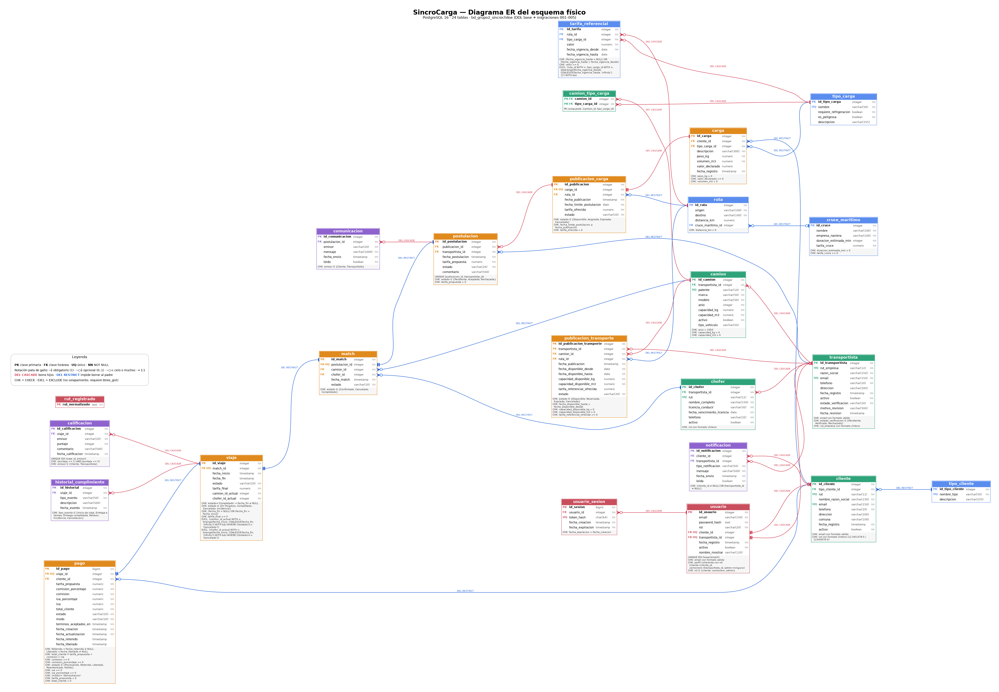
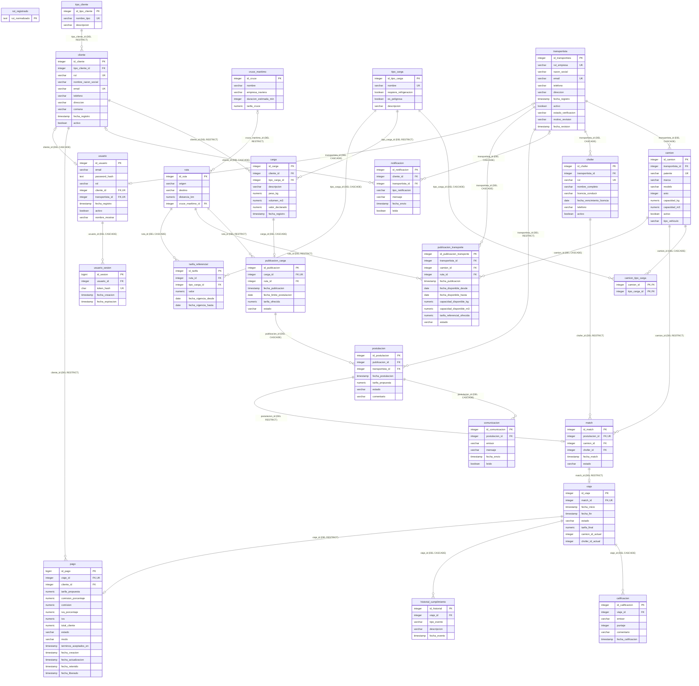

# Diagrama ER del esquema físico

Esquema real de **PostgreSQL 16** (`bd_grupo2_sincrochiloe`) obtenido cargando `databases/bd_grupo2_sincrochiloe.sql` y las migraciones `001`–`005`, y leyendo el catálogo del motor (`pg_constraint`, `information_schema`). No está dibujado a mano: refleja lo que hay en la base.

**Total: 24 tablas** — 21 del DDL base + `usuario`, `usuario_sesion` y `rut_registrado` (migraciones 001 y 004).

Versión vectorial (zoom sin pérdida): [`img/diagrama-er.svg`](img/diagrama-er.svg). Fuente editable: [`img/diagrama-er.dot`](img/diagrama-er.dot) (Graphviz).

**Cómo leerlo:** cada tabla muestra sus columnas con `PK`/`FK`/`UQ` y `NN` (NOT NULL); debajo, los `CHECK` y `EXCLUDE`. Las líneas usan notación pata de gallo y llevan la acción `ON DELETE` (rojo = `CASCADE`, azul = `RESTRICT`).

## Tablas por dominio

| Dominio | Tablas |
|---|---|
| Catálogos y tarifas | `tipo_cliente`, `tipo_carga`, `cruce_maritimo`, `ruta`, `tarifa_referencial` |
| Actores y flota | `cliente`, `transportista`, `camion`, `chofer`, `camion_tipo_carga` |
| Flujo operativo | `carga`, `publicacion_carga`, `publicacion_transporte`, `postulacion`, `match`, `viaje`, `pago` |
| Interacción e historial | `calificacion`, `comunicacion`, `historial_cumplimiento`, `notificacion` |
| Autenticación y seguridad | `usuario`, `usuario_sesion`, `rut_registrado` |

## Claves foráneas y `ON DELETE` (estado actual, con la migración 005)

| Columna hija | Tabla padre | FK obligatoria | ON DELETE | ON UPDATE |
|---|---|---|---|---|
| `calificacion.viaje_id` | `viaje` | sí | **CASCADE** | CASCADE |
| `camion.transportista_id` | `transportista` | sí | **CASCADE** | CASCADE |
| `camion_tipo_carga.camion_id` | `camion` | sí | **CASCADE** | CASCADE |
| `camion_tipo_carga.tipo_carga_id` | `tipo_carga` | sí | **CASCADE** | CASCADE |
| `carga.cliente_id` | `cliente` | sí | **RESTRICT** | CASCADE |
| `carga.tipo_carga_id` | `tipo_carga` | sí | **RESTRICT** | CASCADE |
| `chofer.transportista_id` | `transportista` | sí | **CASCADE** | CASCADE |
| `cliente.tipo_cliente_id` | `tipo_cliente` | sí | **RESTRICT** | CASCADE |
| `comunicacion.postulacion_id` | `postulacion` | sí | **CASCADE** | CASCADE |
| `historial_cumplimiento.viaje_id` | `viaje` | sí | **CASCADE** | CASCADE |
| `match.camion_id` | `camion` | sí | **RESTRICT** | CASCADE |
| `match.chofer_id` | `chofer` | sí | **RESTRICT** | CASCADE |
| `match.postulacion_id` | `postulacion` | sí | **RESTRICT** | CASCADE |
| `notificacion.cliente_id` | `cliente` | no | **CASCADE** | NO ACTION |
| `notificacion.transportista_id` | `transportista` | no | **CASCADE** | NO ACTION |
| `pago.cliente_id` | `cliente` | sí | **RESTRICT** | CASCADE |
| `pago.viaje_id` | `viaje` | sí | **RESTRICT** | NO ACTION |
| `postulacion.publicacion_id` | `publicacion_carga` | sí | **CASCADE** | CASCADE |
| `postulacion.transportista_id` | `transportista` | sí | **RESTRICT** | CASCADE |
| `publicacion_carga.carga_id` | `carga` | sí | **CASCADE** | CASCADE |
| `publicacion_carga.ruta_id` | `ruta` | sí | **RESTRICT** | CASCADE |
| `publicacion_transporte.camion_id` | `camion` | sí | **CASCADE** | CASCADE |
| `publicacion_transporte.ruta_id` | `ruta` | sí | **RESTRICT** | CASCADE |
| `publicacion_transporte.transportista_id` | `transportista` | sí | **CASCADE** | CASCADE |
| `ruta.cruce_maritimo_id` | `cruce_maritimo` | no | **RESTRICT** | CASCADE |
| `tarifa_referencial.ruta_id` | `ruta` | sí | **CASCADE** | CASCADE |
| `tarifa_referencial.tipo_carga_id` | `tipo_carga` | sí | **CASCADE** | CASCADE |
| `usuario.cliente_id` | `cliente` | no | **CASCADE** | NO ACTION |
| `usuario.transportista_id` | `transportista` | no | **CASCADE** | NO ACTION |
| `usuario_sesion.usuario_id` | `usuario` | sí | **CASCADE** | NO ACTION |
| `viaje.match_id` | `match` | sí | **RESTRICT** | CASCADE |

> Total: 31 claves foráneas. Ver el análisis y los cambios en [`revision-restricciones.md`](revision-restricciones.md).

## Restricciones que no son PK/FK/UNIQUE simples

- **`EXCLUDE` (btree_gist):** `tarifa_referencial` impide vigencias solapadas por ruta + tipo de carga; `viaje` impide que un mismo camión o chofer tenga viajes solapados (salvo cancelados).
- **Trigger `sync_actores_viaje()`:** copia `camion_id`/`chofer_id` desde `match` a `viaje.camion_id_actual/chofer_id_actual` para poder construir esos `EXCLUDE`.
- **Índices únicos parciales/funcionales:** `uq_usuario_email_lower` (correo sin distinguir mayúsculas), `uq_calificacion_viaje_emisor` (una calificación por viaje y emisor).
- **`rut_registrado`:** tabla de unicidad global de RUT normalizado (cliente, empresa transportista y chofer comparten espacio de RUT); no tiene FK por diseño.

## Versión Mermaid (se renderiza en GitHub)

Ver diagrama Mermaid

