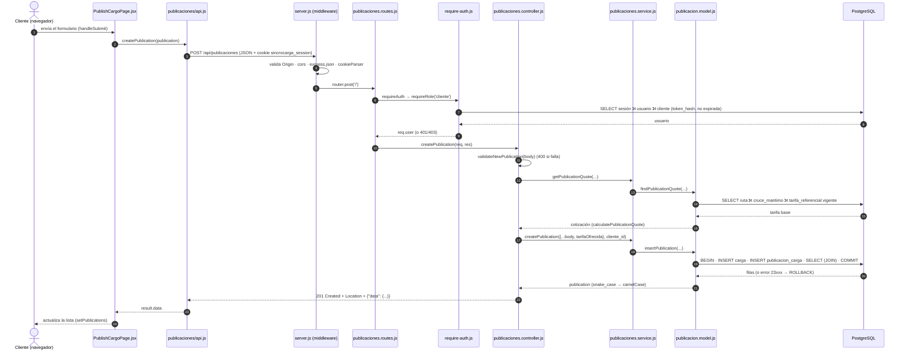

# Ciclo de una petición: React → ruta → servicio → modelo → SQL → JSON

Caso documentado: **publicar una carga** (`POST /api/publicaciones`). Es el flujo que recorre todas las capas del backend N-capas (middleware, autenticación, validación, cotización, transacción con dos `INSERT`) y devuelve JSON. El resto de endpoints sigue el mismo patrón `*.routes.js → *.controller.js → *.service.js → *.model.js`.


Versión vectorial: [`img/flujo-peticion.svg`](img/flujo-peticion.svg) · fuente: [`img/flujo-peticion.dot`](img/flujo-peticion.dot).

## Secuencia



## Qué hace cada capa

| # | Capa | Archivo · función | Responsabilidad |
|---|---|---|---|
| 1 | Vista | `frontend/src/pages/PublishCargoPage.jsx` · `handleSubmit` | Valida que exista cotización vigente y llama a la capa de API; muestra `submitError` si algo falla. |
| 2 | Cliente HTTP | `frontend/src/publicaciones/api.js` · `publicationRequest` | `fetch` a `VITE_API_URL + /api/publicaciones` con `credentials: 'include'`; lanza `Error(result.error)` si `!ok` y devuelve `result.data`. En desarrollo, Vite reenvía `/api` a `localhost:3000`. |
| 3 | Middleware global | `backend/src/server.js` | Rechaza `Origin` no autorizado (403, solo en producción), CORS con credenciales, `express.json` (32 kb), `cookieParser`. |
| 4 | Ruta | `backend/src/routes/publicaciones.routes.js` | Declara `POST /` con `requireAuth` y `requireRole('cliente')`. |
| 4a | Autenticación | `backend/src/middleware/require-auth.js` | Lee la cookie `sincrocarga_session` (HttpOnly; `Secure` + `SameSite=None` en producción), busca la sesión en `usuario_sesion` y deja `req.user`. 401 sin sesión, 403 si el rol no corresponde. |
| 5 | Controlador | `backend/src/controllers/publicaciones.controller.js` · `createPublication` | Valida el cuerpo (400), cotiza (404 sin tarifa) y **recalcula `tarifaOfrecida` en el servidor**; toma el dueño desde `req.user.cliente_id`, nunca del cuerpo. |
| 6 | Servicio | `backend/src/services/publicaciones.service.js` | Fachada entre controlador y modelo (hoy delega; aquí viven las reglas de negocio nuevas). Pricing en `publicaciones.pricing.js`. |
| 7 | Modelo | `backend/src/models/publicacion.model.js` · `createPublication` | Transacción (`BEGIN`/`COMMIT`/`ROLLBACK`), consultas parametrizadas (`$1…`), mapeo a camelCase. |
| 8 | Base de datos | PostgreSQL | Aplica FK, `CHECK` y `UNIQUE` (`carga`, `publicacion_carga`). |
| 9–10 | Respuesta | controlador / `server.js` | `201` + `Location: /api/publicaciones/{id}` + `{ "data": … }`; errores como `{ "error", "details" }`. |

## Mapeo de errores de PostgreSQL a HTTP (`server.js`)

| SQLSTATE | Significado | HTTP |
|---|---|---|
| `23505` | UNIQUE (correo, RUT, postulación duplicada) | 409 |
| `23514`, `23502`, `22001`, `22003`, `22007`, `22P02` | CHECK, NOT NULL, longitud, rango, fecha o formato | 400 |
| `23503` | FK: recurso relacionado inexistente | 404 |
| otros | error no controlado | 500 `Error interno del servidor` |

> Las restricciones de la migración 005 (`CHECK` de formato, estado↔fecha) y los `RESTRICT` pasan por este mismo mapeo.

## Ejemplo

```http
POST /api/publicaciones
Content-Type: application/json
Cookie: sincrocarga_session=<token>

{ "tipoCargaId": 1, "descripcion": "Carga de prueba", "pesoKg": 600, "volumenM3": 4,
  "valorDeclarado": null, "rutaId": 1, "fechaLimitePostulacion": "2027-12-31" }
```
```http
HTTP/1.1 201 Created
Location: /api/publicaciones/42
{ "data": { "id": 42, "tipoCarga": "Carga General", "rutaId": 1, "estado": "Disponible", "tarifaOfrecida": 75000, … } }
```
